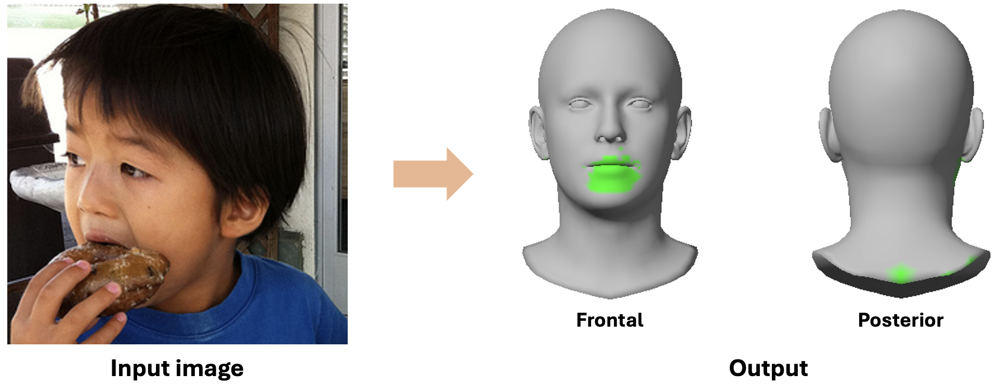

<div align="center">

# HECO: Learning Dense Head-Object Contact Estimation <br> with Synthetic Data

<b>[Daniel Sungho Jung](https://dqj5182.github.io/)</b>, <b>[Kyoung Mu Lee](https://cv.snu.ac.kr/index.php/~kmlee/)</b>

<p align="center">
    
</p>

<b>Seoul National University</b>

<a></a>
<a href="https://pytorch.org/get-started/locally/"></a>
[](https://creativecommons.org/licenses/by-nc/4.0/)
<a href="https://heco-release.github.io/"></a>
<a href="https://arxiv.org/pdf/2611.30751"></a>
<a href="https://arxiv.org/abs/2611.30751"></a>
<br>

<a href="https://huggingface.co/datasets/dqj5182/heco-checkpoints"></a>

<h2>arXiv 2026</h2>



</div>

_**HECO** is a framework for **dense head-object contact estimation** that addresses **diverse head-object interactions** and **hair occlusion**. Using **our synthetic dataset COHE**, HECO learns semantic relationships between head regions and interacting objects through **text-guided semantic alignment**, and infers contact beyond visible regions through **hair occlusion-aware learning with amodal inpainting**._

## Installation

* We recommend you to use an [Anaconda](https://www.anaconda.com/) virtual environment. Install PyTorch >=2.5.1 and Python >=3.10.0. Our latest HECO model is tested on Python 3.10.22, PyTorch 2.5.1, CUDA 12.1.
* Setup the environment.

```
# Initialize conda environment
conda create -n heco python=3.10 -y
conda activate heco

# Install PyTorch
pip install torch==2.5.1 torchvision==0.20.1 --index-url https://download.pytorch.org/whl/cu121

# Install all remaining packages
bash scripts/install_requirements.sh
```

## Data

You need to follow our directory structure of the `data`.

* For quick demo: See [docs/data_demo.md](docs/data_demo.md).
* For evaluation: See [docs/data_eval.md](docs/data_eval.md).

Then, download the official checkpoints and place them in the `release_checkpoint` from [HuggingFace](https://huggingface.co/datasets/dqj5182/heco-checkpoints/tree/main) by running:

```
bash scripts/download_heco_checkpoints.sh
```

## Quick demo

To run HECO on demo images using the [HMR2.0](https://github.com/shubham-goel/4D-Humans) head detector, please run:

```
python demo.py --backbone {BACKBONE_TYPE} --checkpoint {CKPT_PATH} --input_path {INPUT_PATH}
```

For example,

```
# SigLIP2-Giant (Default, WebLI initialized) backbone
python demo.py --backbone siglip2-giant --checkpoint release_checkpoint/heco_final_siglip2_giant_checkpoint.ckpt --input_path asset/example_images
```

## Running HECO

### Test

To evaluate HECO on [DAMON](https://deco.is.tue.mpg.de/), please run:

```
python test.py --backbone {BACKBONE_TYPE} --checkpoint {CKPT_PATH} --test_name DAMON
```

For example,

```
# SigLIP2-Giant (Default, WebLI initialized) backbone
python test.py --backbone siglip2-giant --checkpoint release_checkpoint/heco_final_siglip2_giant_checkpoint.ckpt --test_name DAMON
```

## Acknowledgement

We thank:

* [HACO](https://github.com/dqj5182/HACO_RELEASE) and [FECO](https://github.com/dqj5182/FECO_RELEASE) for dense contact estimation framework.
* [LaMa](https://github.com/advimman/lama) for inspiration on hair occlusion-aware learning.
* [SigLIP2](https://github.com/google-research/big_vision) for inspiration on text-guided semantic alignment.

## Reference

```
@article{jung2026heco,
    title = {Learning Dense Head-Object Contact Estimation with Synthetic Data},
    author = {Jung, Daniel Sungho and Lee, Kyoung Mu},
    journal = {arXiv preprint arXiv:2611.30751},
    year = {2026}
}
```